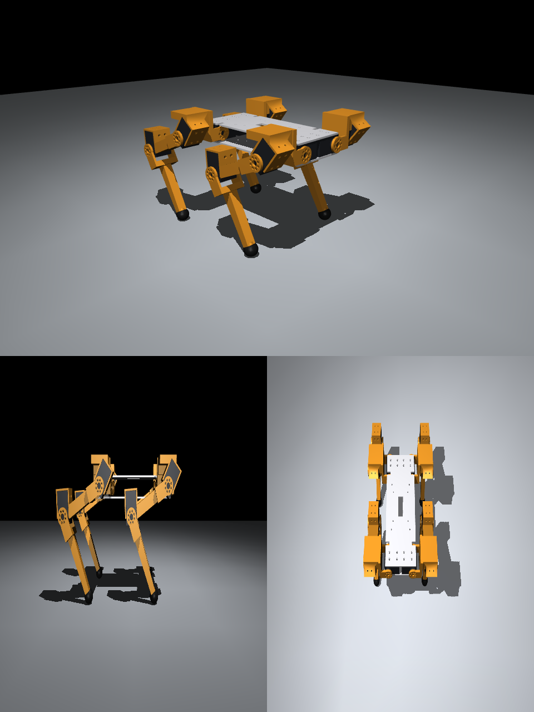

# 설계: SpotMicro → DYNAMIXEL X430 (STS3215 버전은 [sts.md](sts.md))



## 1. 유지한 것과 바꾼 것
| 항목 | SpotMicro | DXL Dog | 비고 |
|---|---|---|---|
| 엉덩이 간격 앞뒤 · 좌우 | 186 · 78 mm | **같음** | mike4192/spotMicro 설정값 |
| 엉덩이 링크 · 허벅지 · 정강이 | 55 · 107.5 · 130 mm | **같음** | 기구학 코드(IK)를 그대로 쓸 수 있음 |
| 서기 높이 (몸 중심) | 155 mm | **같음** (발 포함 167 mm) | |
| 모터 | MG996R (40.7 × 19.7 × 42.9 mm, PWM) | **X430 (28.5 × 46.5 × 34 mm, TTL 버스)** | 모든 모터 장착부를 새로 설계 |
| 무릎 | 무릎에 서보 직결 | **무릎에 직결** | |
| 몸통 | 프린트 프레임 + 덮개 | **위·아래 판이 옆 관절 모터 4개를 직접 잡음** | 덮개는 v0.1에 없음 |
| 무릎 방향 | 뒤로 굽힘 | **뒤로 굽힘** (네 다리 모두) | 뒷다리도 앞다리 부품을 그대로 사용 |

원본 STL은 메시 파일이라 고치기 어렵다. 그래서 **치수를 숫자로 바꿀 수 있는 코드(build123d)**로 처음부터 다시 그렸다. 링크 길이, 모터 종류, 판 두께, 틈을 바꾸고 다시 실행하면 STL/STEP이 새로 나온다.

## 2. 모터 치수 (공식 도면에서 읽음, `cad/x430.py`)
- 몸통 28.5 × 46.5 × 34 mm. 축은 가까운 끝에서 11.25 mm. XL430, XC430, XM430이 **같은 크기·같은 장착 구멍 위치**다.
- 장착 구멍:
  - 폭 면(양쪽): 4개씩. 축에서 길이 방향 4 mm, 28 mm에 두 줄이고, 두께 방향으로 ±6 mm.
  - 먼 끝 면: 16 × 12 mm 사각형으로 4개.
- 혼·아이들러: 16 mm 원 위의 구멍. XL은 4개, XM은 8개 → 부품에는 **45° 간격 8개**를 뚫어 둘 다 맞게 했다.
- 다른 점:
  - 혼·아이들러 돌출: XL 3.9 / 3.0 mm, XM 2.2 / 2.0 mm → 포크 팔 간격을 모터 종류별로 계산
  - 장착 나사: XL M2.6 탭핑, XM M2.5 탭

## 3. 관절 구조 (세 관절이 같은 원리)
```
          ┌──────── 앞 부품: 하우징 ────────┐
          │ 옆판(폭 면 구멍 4개) ×2 + 먼 끝 판 │  ← 모터 몸통을 잡는다 (모터 두께 34 mm 안)
          └───────────────┬────────────────┘
            모터 [혼 ● 아이들러]  ← 축
          ┌──── 다음 부품: 포크 ────┐
          │ 혼 쪽 팔 │      │ 아이들러 쪽 팔 │  ← 모터 바깥 면에서 양쪽으로 잡음 (축 하나를 두 점에서 지지)
          └────── 다리 (축에서 24–34 mm) ──────┘
```
- 포크의 **다리**가 축에서 24 mm 이상 떨어져 있어서 모터 몸통 모서리(18 mm)에 닿지 않는다. 그래서 관절은 모터 몸통이 향한 방향(±45°)만 피하면 넓게 돈다.
- **모터 방향**: 각 모터의 '먼 끝'이 그 관절이 움직이는 범위의 **반대쪽**을 향하게 놓았다.

| 관절 | 필요한 범위 | 모터 놓은 방향 |
|---|---|---|
| hip_x (옆으로 벌리기) | ±30° | 축 = 앞뒤, 몸통은 몸 가운데를 향함. 위·아래 몸통 판이 하우징 역할 |
| hip_y (앞뒤 흔들기) | 허벅지 −95° (뒤) ~ +20° (앞) | 축 = 좌우, 몸통은 '위-앞' (범위 가운데 −37.5°의 반대) |
| knee (무릎) | 15° ~ 125° 굽힘 | 축 = 좌우, 몸통은 무릎 뒤쪽 (범위 가운데 70°의 반대) |

## 4. 부품 목록 (`cad/out/<구성>/`)
| 파일 | 수량 | 크기 (mm) | 어림 질량 | 설명 |
|---|---|---|---|---|
| `body_top.stl`, `body_bottom.stl` | 1 · 1 | 222 × 96 × 3 | 약 42 g씩 | 옆 관절 모터 4개를 위·아래에서 잡음. Raspberry Pi 구멍, 케이블 구멍 |
| `body_pillar.stl` | 4 | Ø9 × 28.8 | 1 g | 위·아래 판 사이 기둥 |
| `shoulder_FL.stl` / `_FR` | 2 / 2 | 65 × 85 × 55 | 약 42 g | 옆 관절 포크 + 앞뒤 관절 모터 하우징 |
| `thigh_FL.stl` / `_FR` | 2 / 2 | 55 × 53 × 138 | 약 37 g | 앞뒤 관절 포크 + 무릎 모터 하우징 |
| `shank_FL.stl` / `_FR` | 2 / 2 | 26 × 53 × 143 | 약 27 g | 무릎 포크 + 정강이 |
| `foot.stl` | 4 | Ø24 | 3 g | TPU 권장. M3 나사로 고정 |
| `gauge_*.stl` | 1씩 | 작음 | – | **맞춤 시험용** (아래 6장) |

`_FL`은 왼쪽 다리(앞왼쪽·뒤왼쪽), `_FR`은 오른쪽 다리용이다. 앞다리와 뒷다리는 같은 부품을 쓴다.

222 mm 판은 220 × 220 프린터에서 대각선으로 놓고 인쇄한다.

## 5. 검증
- **충돌 검사** (`cad/check.py`): 세 관절의 범위를 촘촘히 나눈 **405개 자세**에서 모든 부품·모터 쌍이 겹치는 부피를 계산했다. 네 구성(xl, xm, mixed, sts) 모두 **충돌 0**.
  - 설계하면서 찾아 고친 문제: 밀어내기 방향이 점 순서 때문에 뒤집혀 팔이 두꺼워진 것, 어깨 팔이 허벅지 팔 면을 침범한 것, 옆 관절이 ±30°일 때 몸통 판에 닿은 것(홈을 냄)
- **조립 그림** (`cad/render.py`): 서기·쉬기 자세 미리보기 → `cad/out/preview_*.png`
- **질량**: CAD 부피 × PETG/PLA 밀도 × 0.55(채움 어림) → 시뮬레이션에 다시 넣어 모터 선정을 확인했다 (`sim/verify_cad_mass.py`).

## 6. 인쇄 전에 확인할 것 (맞춤 시험)
도면에 없는 치수(혼 높이, 아이들러 두께)와 인쇄 공차는 **실제 모터로 확인**해야 한다. 큰 부품을 뽑기 전에 다음 세 개를 먼저 인쇄한다(합계 약 30분).
1. `gauge_horn`: 혼과 아이들러에 대 보고 8개 구멍 중 4개(또는 8개)가 나사와 맞는지, 가운데 구멍이 혼 중심과 맞는지 본다.
2. `gauge_side_holes`: 모터 폭 면에 대 보고 4개 구멍 위치를 확인한다(축 표시 구멍을 출력축에 맞춤).
3. `gauge_case_ring`: 모터가 너무 빡빡하거나 헐겁지 않게 들어가는지 본다(틈 0.3 mm).

맞지 않으면 `cad/x430.py`의 값(`CLEAR`, `SIDE_HOLES`, `horn_proud` 등)을 고치고 `build_all.py`를 다시 실행한다.

## 7. 아직 하지 않은 것 (v0.2 후보)
- 케이블 경로·고정 구멍, 배터리 고정대, 몸통 덮개(SpotMicro 모양)
- 포크 팔 강도 해석 (1단계 실물 시험으로 대신)
- 인쇄 방향을 정해 둔 STL (지금은 조립 좌표로 내보냄 → 슬라이서에서 눕혀서 인쇄)
