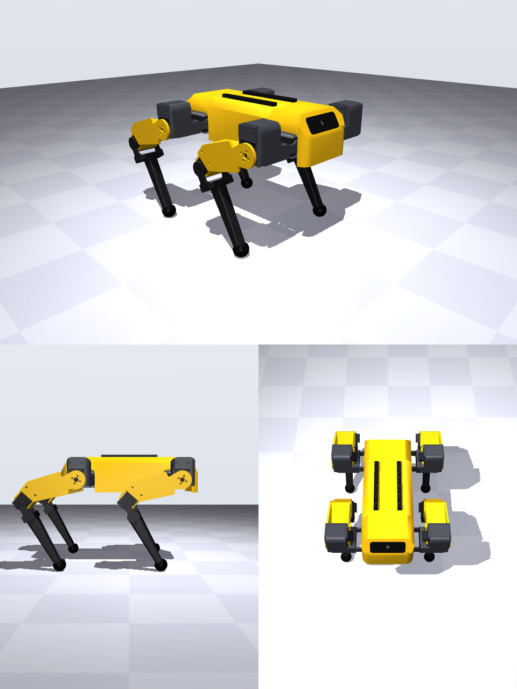

# 설계 v2 — Spot을 참고해 다듬은 모양

v1([design.md](design.md))은 모터를 잡는 기능에 맞춰 만들어서 상자와 판이 그대로 드러났다. v2는 Boston Dynamics **Spot**의 모양을 참고해 겉모양을 정리했다. 기구학은 그대로이므로 **소프트웨어와 학생 코드는 바뀌지 않는다**.


## 1. 바뀐 것
| 부분 | v1 | v2 (Spot 참고) |
|---|---|---|
| 몸통 | 위·아래 판과 모터가 드러남 | **노란 덮개**로 감쌈. 위 긴 모서리를 깎았고, 앞뒤 끝은 비스듬함<br>앞·뒤에 **검은 얼굴판**(눈 두 개 + 카메라 렌즈 구멍)<br>위에 **검은 레일** 2개(M3 구멍 20 mm 간격, 센서 달기) |
| 어깨 (hip_y 모터) | 37.5° 기울어진 상자 | 모터를 **세워서**(먼 끝이 위) 모서리가 둥근 **엉덩이 통**에 넣음 |
| 허벅지 | 포크 팔 + 가는 기둥 + 기울어진 무릎 상자 | 바깥 면이 **엉덩이 원판(반지름 22 mm)에서 무릎까지 한 장**<br>무릎 모터는 허벅지 방향에서 뒤로 25°만 기울여 허벅지 안에 넣음 |
| 정강이 | 네모난 막대 | 가늘고 모서리가 둥근 **검은 정강이** |
| 포크 팔 | 원판 + 넓은 띠 | 원판 + **가는 목** + 끝 패드. 관절이 돌 때 다른 부품과의 틈이 넓어짐 |

## 2. 그대로인 것
- 관절 위치, 링크 길이(55 · 107.5 · 130 mm), 관절 범위(hip_x ±30°, hip_y −95…20°, knee 0…125°)
- 모터 종류 4가지 구성(xl, xm, mixed, sts), 혼·케이스 나사 구멍, 맞춤 시험 부품(`gauge_*`)
- 위·아래 몸통 판이 옆 관절 모터 4개를 잡는 방식. 덮개 옆 벽이 들어가도록 가운데 부분만 조금 좁혔다(반폭 45.6 mm).
- 모터 방향이 바뀐 관절(hip_y, knee)도 **조립할 때 모든 모터 2048에서 다리를 똑바로 아래로** 맞추는 규칙은 같다. 모터 몸통이 놓인 방향만 다르다.

## 3. 부품 (`cad/out/v2/<구성>/`, 권장 구성 mixed 기준)
| 파일 | 수량 | 어림 질량 | 인쇄 |
|---|---|---|---|
| `body_top`, `body_bottom`, `body_pillar` | 1 · 1 · 4 | 40 · 41 · 1 g | v1과 같음 (덮개 나사 구멍 추가) |
| `cover_mid` (가운데 덮개) | 1 | 69 g | 윗면을 바닥에 놓으면 받침 없이 인쇄된다 (141 × 96 × 68 mm) |
| `cover_end` (앞·뒤 끝 덮개) | 2 | 31 g | 같은 부품. 뒤에는 180° 돌려서 단다 |
| `face_plate` (얼굴판, 검은색) | 2 | 5 g | 바깥 면을 바닥에. 안쪽 턱으로 덮개 창에 안에서 끼운다 |
| `rail` (레일, 검은색) | 2 | 4 g | 가운데 덮개 위에 M3 나사 5개씩 |
| `shoulder_FL` / `_FR` | 2 / 2 | 28 g | 받침 필요 (v1과 같음) |
| `thigh_FL` / `_FR` | 2 / 2 | 40 g | **바깥 면을 바닥에**: 가볍게 하려고 판 홈이 안쪽(위)으로 열린다. 안쪽 팔은 받침 필요 |
| `shank_FL` / `_FR` | 2 / 2 | 27 g | 옆으로 눕혀서, 받침 필요 |
| `foot`, `gauge_*` | 4, 1씩 | 3 g | v1과 같음 |

프린트 부품 합계는 약 **626 g**으로 v1(약 524 g)보다 100 g쯤 무겁다. 대부분 덮개 무게다. STS 구성은 약 641 g이다.

색은 Spot처럼 정했다.
- 노랑 PETG: 덮개, 허벅지
- 검정: 얼굴판, 레일, 정강이
- 짙은 회색: 어깨

색이 하나뿐이어도 조립에는 상관없다.

### 덮개 다는 순서
1. 위·아래 판, 옆 관절 모터, Raspberry Pi를 먼저 조립한다. Pi는 위 판 위, 덮개 안쪽(높이 약 24 mm)에 들어간다.
2. 얼굴판을 끝 덮개 창에 안쪽에서 끼운다(접착제 조금).
3. 가운데 덮개를 올린다. 기둥 2개를 M3 탭핑 나사로 고정하는데, 나사는 **위 판 아래에서 위로** 조인다. 드라이버는 아래 판의 Ø7 구멍으로 넣는다.
4. 끝 덮개 2개를 가운데 덮개의 턱에 끼우고, 각각 기둥 2개를 같은 방법으로 고정한다. 나사 자리는 x = ±85, ±105 mm이고, 앞 옆 관절 모터 두 개 사이 틈(7.5 mm)에 있다.

## 4. 검증
- **충돌 검사** (`check.py <구성> v2 fine`)
  - 범위를 촘촘히 나눈 405개 자세를 검사했다. 무릎 0°도 넣었다(조립 자세).
  - 앞다리와 뒷다리 모두를 덮개·얼굴판·레일·몸통 판·옆 관절 모터 4개와 함께 검사했다.
  - mixed, sts는 **충돌 0**이다. xl, xm은 기본 90개 자세에서 **충돌 0**이다.
- **부품이 한 덩어리인지**: 모든 부품이 고체 하나로 나오는 것을 확인했다(떠 있는 조각 없음).
- **모터 부하** (`sim/` 토크 시뮬레이션, CAD 질량을 넣음): 전체가 약 0.1 kg 무거워지지만, 걷기 부하는 1–2 %p만 오른다.
  - XM430-W350: 무릎 23 %로 같다.
  - XL430-W250: 무릎 58 → 59 %
- 설계하면서 고친 점:
  - 둥근 모서리 때문에 엉덩이 통 뒤 벽이 떨어져 나간 문제 → 벽을 4.5 mm로 두껍게 했다.
  - 덮개 사이 턱과 몸통 판이 겹친 문제 → 몸통 판을 좁히는 범위를 넓혔다.

## 5. 시뮬레이터
시뮬레이터와 스튜디오 3D 화면도 v2 모양이다. `export_sim_assets.py <구성> v2`가 부품 메시·질량과 덮개 메시를 `software/dxldog/assets/<구성>/`에 쓴다.
- 덮개 메시는 두 개다: `cover`(노랑), `cover_dark`(얼굴판·레일).
- 시뮬레이터는 `frames.json`의 `"style": "v2"`를 보고 Spot 색을 쓴다.
- v1로 되돌리려면 `export_sim_assets.py <구성> v1`을 실행한다.

| 시뮬레이션 (mixed) | v1 | v2 |
|---|---|---|
| 전체 질량 (배터리·전자부품 포함) | 1.78 kg | 1.90 kg |
| 무게중심 (몸통 중심 기준 앞뒤) | −1.1 mm | −1.3 mm |
| J6: 센서 없이 duty 0.5 트롯 10주기 | 0.33 m, 최대 10.3° 기울어짐 | 0.83 m, 4.3° |
| J6: 균형 잡기 | 0.84 m, 2.3° | 0.86 m, 2.2° |
| J6: 균형 + 방향 잡기 20주기 | 1.67 m | 1.75 m |

무게중심이 거의 같아서 서기 자세와 걸음새 값(발 3.5 cm 뒤)은 그대로 쓴다. STS는 1.55 → 1.66 kg이고, 균형 + 방향 잡기 결과는 1.59 → 1.64 m다.

## 6. 만들기
```powershell
cd cad
..\.venv\Scripts\python build_all.py mixed v2       # STL/STEP → out/v2/mixed/
..\.venv\Scripts\python check.py mixed v2 fine      # 충돌 검사 (405개 자세, 약 7분)
..\.venv\Scripts\python render.py mixed stand v2    # 미리보기 → out/preview_v2_mixed_stand.png
```
STS 구성은 `mixed` 대신 `sts`를 쓴다.



## 7. 아직 확인하지 않은 것 ⚠️
- **실물로 인쇄하지 않았다.** 덮개 턱(틈 0.2 mm), 얼굴판 창(틈 0.2 mm), 덮개 기둥 나사 자리는 프린터에 따라 다를 수 있다. 맞춤 시험 부품은 v1과 같다.
- **카메라 고정대는 아직 없다.** 얼굴판에 렌즈 구멍(Ø8)만 뚫었다.
- **케이블 길이**: 무릎 모터 방향이 바뀌어 허벅지 안 케이블 경로가 v1과 다르다. 실물에서 길이를 확인한다.
