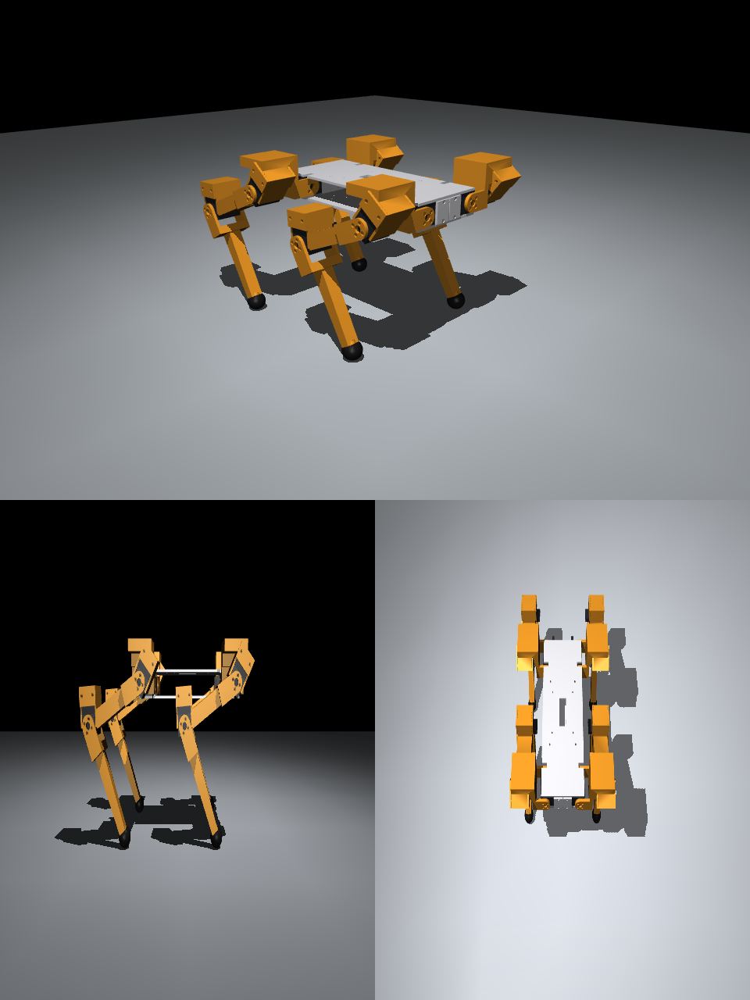

# STS 버전 — LeRobot 모터(Feetech STS3215)로 만들기

이미 가지고 있는 **LeRobot(SO-100/SO-101)용 Feetech STS3215** 버스 서보 12개로 같은 로봇개를 만드는 구성이다. 다리 길이·관절 범위·자세·학생 코드는 DYNAMIXEL 버전과 **같다**. 바뀌는 것은 모터를 잡는 부품 모양, 통신 장치, 설정 한 줄이다.



## 1. 힘이 충분한가 (시뮬레이션)
CAD 질량을 넣은 시뮬레이터에서 새 걸음새(딛는 비율 0.65)로 30초 걸었다. 숫자는 정지 토크 대비 부하다.

| 구성 | 전체 무게 | 서 있기 (무릎) | 걷기 평균 (hip_x / hip_y / knee) | 걷기 순간 최대 |
|---|---|---|---|---|
| DYNAMIXEL 권장 (XL430 + XM430) | 1.78 kg | 7 % | 10 / 12 / 16 % | 38 % |
| **STS3215 12 V × 12** | 1.53 kg | 9 % | 5 / 17 / 23 % | 47 % |
| STS3215 7.4 V × 12 | 1.53 kg | 14 % | 8 / 28 / 38 % | 71 % |

- **12 V판(STS3215-C018, 30 kg·cm)이면 여유 있게 걷는다.** SO-101 팔로워 팔에 들어가는 모터다.
- 7.4 V판(19.5 kg·cm)도 걷기는 하지만 무릎이 정지 토크의 70 %까지 쓰여 오래 걸으면 뜨거워진다. 짧은 시연용.
- SO-101 **리더 팔** 모터는 감속비가 관절마다 달라(1/147, 1/191, 1/345) 섞어 쓰면 안 된다. 다리에는 **1/345 감속 모터만** 쓴다.
- 사양: 12 V판 정지 토크 30 kg·cm(2.94 Nm), 무부하 0.222 s/60°(약 45 rpm), 정지 전류 2.7 A, 55 g. ⚠️ 판매처 사양 기준.

## 2. 모터 치수와 장착 방식
Feetech 장착 도면을 구하지 못해서 **SO-ARM100 저장소의 STS3215 3D 모델을 직접 쟀다** (`cad/sts3215.py`). 판매처 사양(45.2 × 24.7 × 35 mm)과 맞는다. ⚠️ 맞춤 시험 필수.

| 항목 | DYNAMIXEL X430 | STS3215 |
|---|---|---|
| 몸통 (폭 × 길이 × 두께) | 28.5 × 46.5 × 34 mm | 24.8 × 45.4 × 34.7 mm |
| 축 → 가까운 끝 / 먼 끝 | 11.25 / 35.25 mm | 10.2 / 35.2 mm |
| 혼 쪽 면에서 혼 돌출 | XL 3.9 / XM 2.2 mm | **1.7 mm** |
| 뒤쪽 원판(아이들러) | 있음 | 있음 (두 축 모터), 돌출 0.6 mm |
| 혼 나사 | 16 mm 원 위 4·8개 | **한 변 10 mm 정사각형 4개** |
| 장착 나사 구멍 | **옆면(폭 면)** 4개씩 + 먼 끝 4개 | **앞·뒤 면** 4개씩 (옆면에는 없음) |
| 커넥터 | 몸통 끝 | **뒷면**, 축에서 11.5–17 mm (케이블이 아래로 나옴) |

그래서 부품을 이렇게 바꿨다.
- **하우징**: 옆판(구멍 없음) + 먼 끝 판으로 모터를 감싸고, **앞·뒤 면의 먼 쪽 구멍 2개씩**(축에서 29–33 mm)을 얇은 장착판으로 나사 고정한다. 장착판은 축에서 19 mm부터 시작해서 포크 팔과 커넥터를 피한다. 모터는 가까운 끝 쪽에서 밀어 넣는다.
- **몸통**: 옆으로 벌리기 모터 4개는 위·아래 판이 폭 면을 잡고, **아래 판에 세운 벽**이 앞·뒤 면을 나사로 잡는다(아래 판과 한 몸으로 인쇄).
- **포크 팔**: 혼 구멍 4개(10 mm 정사각형), 축 둘레 원판 반지름 11 mm(뒷면 커넥터를 피함).
- 다리 길이·관절 위치는 같으므로 기구학·시뮬레이터·예제는 그대로다.

## 3. 검증
- 충돌 검사(`cad/check.py sts`): 75개 자세, 그리고 범위를 촘촘히 나눈 405개 자세에서 부품·모터·꽂은 케이블 자리끼리 겹침 없음. 관절 범위는 DYNAMIXEL 버전과 같다 (hip_x ±30°, hip_y −95…20°, knee 0…125°).
- 프린트 부품 합계 약 530 g (DYNAMIXEL 버전과 비슷).
- 고친 문제 (2026-10-12)
  - 면 장착판이 하우징 벽에서 0.15 mm 떠 있어서 따로 떨어진 조각으로 인쇄되던 문제 → 벽을 틈만큼 늘려 붙였다.
  - 아래 판의 뒤쪽 옆 관절 모터 벽이 앞뒤가 뒤집혀 모터와 겹치고 구멍이 맞지 않던 문제 → 뒷다리 모터는 앞 모터를 그대로 옮긴 것이라 벽도 그대로 옮겼다.
  - 그 전에 STS 부품을 뽑았다면 `shoulder`, `thigh`, `body_bottom`을 다시 뽑는다.
- Spot 모양으로 다듬은 **v2**도 STS로 만들 수 있다: `build_all.py sts v2` ([design_v2.md](design_v2.md)).

## 4. 부품 목록 (1대)
| 품목 | 수량 | 비고 |
|---|---|---|
| Feetech STS3215 **12 V, 1/345** (C018) | 12 | 가지고 있는 SO-101 팔로워 모터를 써도 된다 |
| 버스 서보 어댑터 (Feetech FE-URT-1 또는 Waveshare Bus Servo Adapter) | 1 | SO-101 키트에 들어 있는 보드. USB로 노트북·Raspberry Pi에 연결 |
| 12 V 직류 전원 10 A 이상 ⚠️ | 1 | 모터 정지 전류 2.7 A × 12. 걷기 평균은 훨씬 적지만 넉넉하게 |
| 3핀 버스 케이블 | 12 | 모터에 들어 있는 것. 다리마다 3개를 이어 붙임 |
| 프린트 부품 | `cad/out/sts/` | PETG 권장 |
| 나사 | M2 ⚠️ | 케이스 구멍 지름 약 2 mm (모델에서 잼). 혼 나사는 모터에 들어 있는 것 |

## 5. 인쇄 전 맞춤 시험 (`cad/out/sts/gauge_*`)
1. `gauge_horn`: 혼과 뒤쪽 원판에 대 보고 4개 구멍이 맞는지 본다.
2. `gauge_face_top`, `gauge_face_bottom`: 큰 구멍을 원판에 끼우고 장착 구멍 2개가 케이스 구멍과 맞는지 본다.
3. `gauge_case_ring`: 모터가 너무 빡빡하거나 헐겁지 않은지 본다(틈 0.3 mm).

맞지 않으면 `cad/sts3215.py` 값을 고치고 `build_all.py sts` → `check.py sts` → `export_sim_assets.py sts`를 다시 돌린다.

## 6. 만들기 (CAD)
```powershell
cd cad
..\.venv\Scripts\python build_all.py sts          # STL/STEP → out/sts/
..\.venv\Scripts\python check.py sts              # 충돌 검사
..\.venv\Scripts\python render.py sts stand       # 미리보기
..\.venv\Scripts\python export_sim_assets.py sts  # 시뮬레이터 자산 → software/dxldog/assets/sts/
```

## 7. 소프트웨어 (학생 코드는 같다)
로봇 종류만 `sts`로 고르면 된다. 고르는 방법 (위에 있는 것이 먼저):
1. 코드에서 `Dog(robot="sts")`, 또는 예제·도구·스튜디오에 `--robot sts`
2. 환경 변수 `DXLDOG_ROBOT=sts`
3. 한 번 저장해 두기: `python -m dxldog.tools use sts` → `~/.dxldog/robot.json`

```powershell
cd software
..\.venv\Scripts\python -m dxldog.tools use sts                     # 이 컴퓨터의 기본 로봇을 STS 로
..\.venv\Scripts\python -m dxldog.tools setup FL hip_x --port COM5   # 모터 하나씩 ID 설정 (12번)
..\.venv\Scripts\python -m dxldog.tools scan --port COM5
..\.venv\Scripts\python -m dxldog.tools calibrate --port COM5
..\.venv\Scripts\python -m dxldog.tools check --port COM5           # 방향 확인 ⚠️ 아래 참고
..\.venv\Scripts\python lessons\j2_poses.py --real COM5
studio\run_studio.bat --robot sts --backend real --port COM5
```
- 통신: Feetech 버스(`scservo_sdk`), 1 Mbps. 레지스터 주소가 DYNAMIXEL과 다르다 (예: Goal Position 42번, 2바이트). 표는 [software.md](software.md).
- 시뮬레이터: `assets/sts`(STS 부품 모양·무게)로 돈다. 예제 J1–J6 모두 시뮬·가짜 모터에서 확인.

⚠️ 아직 실제 STS 모터로 확인하지 못한 것
- **회전 방향**: STS의 + 방향이 DYNAMIXEL과 같다고 두었다. `tools check`에서 12개가 모두 반대로 움직이면 `config.py`의 sts `dir_sign`을 −1로 바꾼다.
- **SO-101 팔에서 뺀 모터를 쓰면**: `setup`이 ID와 Homing Offset(0으로)을 다시 쓰므로 **LeRobot 팔 보정이 지워진다**. 나중에 팔에 다시 달 때는 LeRobot의 모터 설정·보정을 다시 해야 한다.
- 온도 한계 70 °C, 속도 레지스터 단위, 잠금(Lock) 동작은 판매처·LeRobot 자료 기준이다.
